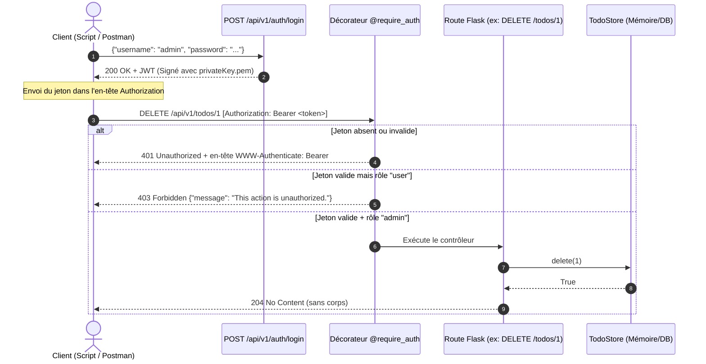
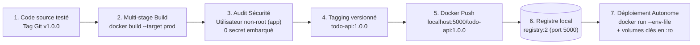

# Guide de Soutenance & Plan de Scalabilité (ESGI 4-SRC)

**Épreuve** : API REST pour l'administration système  
**Format** : Soutenance orale (10 à 15 minutes à 4)  
**Date** : 26/11/2026  
**Livrables** : Dépôt Git (tag `v1.0.0`), Swagger complet, collection Postman/Newman, image Docker de production, CHANGELOG et README.

---

## 1. Déroulé & Répartition de la Soutenance (10 à 15 minutes)

| Temps | Rôle / Intervenant | Thématique | Points clés à aborder |
| :--- | :--- | :--- | :--- |
| **00:00 - 03:00** | **Membre 1** | **Contexte métier & Architecture REST** | • Problématique du tableur d'exploitation en PME (pas d'historique, failles, non automatisable).<br>• Présentation des ressources et routes REST : `POST`, `GET`, `PATCH`, `DELETE`, filtre `?done=`.<br>• Démonstration rapide du contrat interactif **Swagger UI** (`/api/docs`). |
| **03:00 - 06:00** | **Membre 2** | **Sécurité : JWT & RBAC (Rôles)** | • Présentation du **Schéma de sécurisation**.<br>• Explication des contrôles : route publique (`/health`, `/auth/login`) vs routes protégées (`@require_auth()`) vs route admin (`@require_auth(ROLE_ADMIN)`).<br>• Différence stricte entre `401 Unauthorized` (pas/mauvais jeton) et `403 Forbidden` (rôle insuffisant).<br>• Preuve de non-exposition des secrets (pas de clés RSA ni `.env` dans l'image ou Git). |
| **06:00 - 09:00** | **Membre 3** | **Stratégie de Test & Assurance Qualité** | • Démonstration des tests unitaires Pytest (concurrence thread-safe 100 tâches, nominal, erreurs 404/422).<br>• Démonstration de la collection **Postman** rejouable avec assertions JSON Schema.<br>• Exécution automatisée en ligne de commande via **Newman** (CLI). |
| **09:00 - 12:00** | **Membre 4** | **Publication & Déploiement Docker** | • Présentation du **Schéma de publication**.<br>• Dockerfile multi-stage (`target: prod`), utilisateur non-root (`USER app`), aucun secret dans l'image.<br>• Démonstration du registre local `registry:2` (`localhost:5000`) et inspection via `curl http://localhost:5000/v2/_catalog`.<br>• Lancement autonome de l'image de production avec montage sécurisé des clés en lecture seule (`:ro`). |
| **12:00 - 15:00** | **Collectif** | **Scalabilité (« Passer en prod ») & Questions** | • Analyse critique des limites actuelles (stockage en mémoire vive, mono-processus).<br>• Architecture cible pour scaler (PostgreSQL, Stateless, Horizontal Pod Autoscaling, Reverse Proxy/TLS, Redis pour Rate-Limiting).<br>• Réponses aux questions du jury. |

---

## 2. Les Deux Schémas Obligatoires

### Schéma 1 : Chaîne de Sécurisation (JWT & RBAC)



### Schéma 2 : Chaîne de Publication & Déploiement Docker



---

## 3. Scaler l'Architecture : Argumentaire Technique pour l'Oral

Le projet de base stocke les données dans un dictionnaire Python protégé par un verrou mémoire (`threading.Lock()`). Cette approche simplifie le TP mais pose des limites majeures pour une mise en production :
- **Perte de données** à chaque redémarrage de l'API.
- **Interdiction du multi-processus** : plusieurs instances ou workers gunicorn auraient chacun leur mémoire séparée, brisant la cohérence des données.

### L'Architecture Cible Haute Disponibilité (Production)

```mermaid
flowchart TD
    subgraph CLIENTS["Clients Externes"]
        CLI["Scripts d'exploitation"]
        WEB["Dashboard Web / Front"]
    end

    subgraph EDGE["Edge & Sécurité"]
        RP["Reverse Proxy / API Gateway (Nginx / Traefik)<br/>• Terminaison TLS / HTTPS (Let's Encrypt)<br/>• WAF & Protection DoS / Quota 429 (Redis)"]
    end

    subgraph CLUSTER["API Stateless (Scalabilité Horizontale)"]
        direction LR
        POD1["Instance 1 (Gunicorn multi-workers)"]
        POD2["Instance 2 (Gunicorn multi-workers)"]
        POD3["Instance N (Auto-scalée HPA)"]
    end

    subgraph SECSTORE["Gestion des Secrets & Identité"]
        VAULT["Secret Manager (Vault / AWS SM)<br/>Rotation automatique des clés RSA"]
        IAM["Serveur IAM (Keycloak / OIDC)<br/>Émission des JWT & JWKS"]
    end

    subgraph STORAGE["Persistance Partagée Haute Disponibilité"]
        PG[("PostgreSQL Cluster<br/>(Master / Répliques en lecture)")]
        REDIS[("Redis Cluster<br/>(Cache & Rate Limiting distribué)")]
    end

    CLIENTS -->|HTTPS (Port 443)| RP
    RP -->|Load Balancing Round-Robin| CLUSTER
    CLUSTER --> PG
    CLUSTER --> REDIS
    IAM -.->|Validation clés publiques| CLUSTER
    VAULT -.->|Injection sécurisée| CLUSTER
```

### Les 5 axes d'amélioration à expliquer au jury :

1. **Persistance des données (PostgreSQL)** :
   - Remplacer `TodoStore` par une base relationnelle (PostgreSQL avec SQLAlchemy / Alembic pour les migrations).
   - Utilisation d'un pool de connexions (ex: `PgBouncer` ou pool SQLAlchemy) pour absorber des milliers de requêtes concurrentes.
2. **Stateless réel & Scalabilité horizontale** :
   - L'API ne conservant plus d'état en mémoire vive, elle devient 100 % conforme à la contrainte **Stateless** de REST.
   - On peut lancer `gunicorn` avec `(2 x CPU) + 1` workers par instance et déployer plusieurs conteneurs derrière un répartiteur de charge (*Load Balancer*).
3. **Distribution et rotation des clés JWT** :
   - Plutôt que des fichiers `.pem` montés localement, utilisation d'un endpoint standard **JWKS** (`.well-known/jwks.json`) hébergé par un serveur d'authentification dédié (Keycloak, Auth0) ou récupération via un gestionnaire de secrets (HashiCorp Vault).
4. **Gestion du trafic et Rate Limiting (HTTP 429)** :
   - Mettre en place un middleware de quota (ex: 100 requêtes/minute par client IP ou par utilisateur) basé sur un cache Redis partagé.
5. **Observabilité (Métriques & Logs)** :
   - Exporter des métriques Prometheus (`/metrics`) pour suivre le temps de réponse et les codes d'erreur HTTP.
   - Centraliser les logs applicatifs (Loki / ELK) avec des ID de corrélation (`X-Request-ID`).
